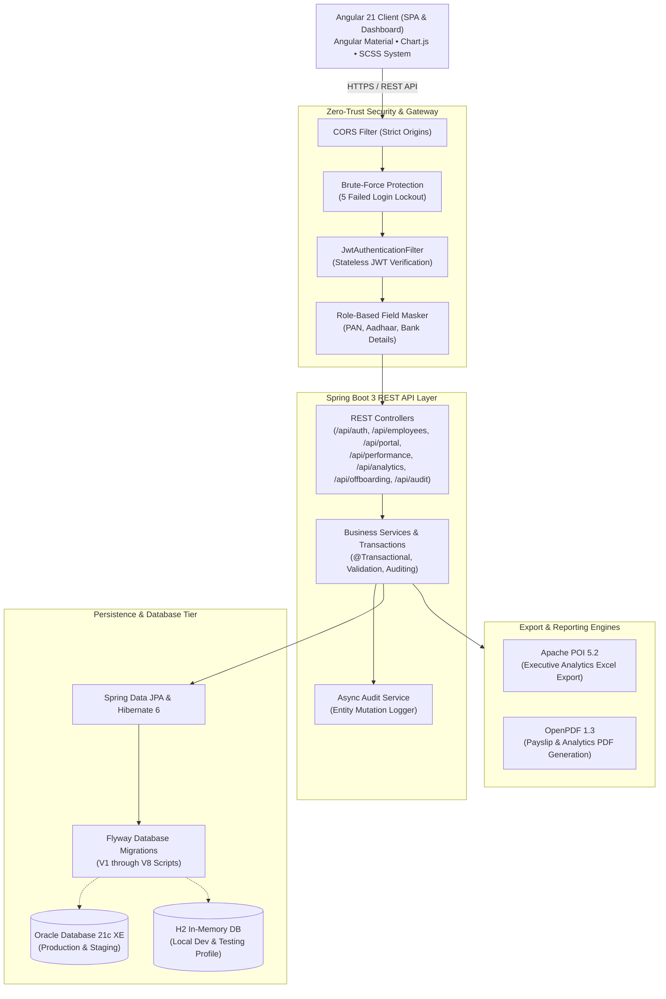

# HRGenius — Enterprise Human Resources Management System

[](https://github.com/ayukaushik1357-bit/HRGenius/actions)
[](https://spring.io/projects/spring-boot)
[](https://angular.dev)
[](https://www.oracle.com/database/technologies/appdev/xe.html)
[]()

**HRGenius** is a full-stack, enterprise-grade Human Resources Management and Workforce Intelligence platform. Built with Java 17, Spring Boot 3, Hibernate/JPA, Angular 21, and Oracle Database, it covers the complete employee lifecycle—from recruitment and onboarding to attendance, leave, statutory payroll, performance appraisal cycles, full & final settlement, compliance auditing, and executive analytics.

---

## 🏛️ System Architecture



---

## 🛠️ Technology Stack

| Layer | Technologies & Libraries |
| :--- | :--- |
| **Backend Framework** | Java 17+, Spring Boot 3.2.5, Spring MVC, Spring Data JPA, Spring Security 6 |
| **Authentication & Tokens**| In-Memory JWT Access Tokens, HttpOnly Secure SameSite Cookies (Refresh Tokens), BCrypt Password Hashing |
| **Frontend Framework** | Angular 21, TypeScript 5, Angular Material, SCSS Theming, RxJS Signals & Observables |
| **Data Visualisation** | Chart.js 4.4 (Canvas-based Headcount, Attrition Trend, Recruitment Funnel, Rating Distribution) |
| **Databases** | Oracle Database 21c Express Edition (`XEPDB1`) and In-Memory H2 (`profile: h2`) |
| **Schema Migration** | Flyway (8 Versioned Migration Scripts: V1 through V8) |
| **Reporting & Documents**| Apache POI 5.2.5 (`.xlsx` Analytics Reports), OpenPDF 1.3.39 (Payslip & Executive Summary PDFs) |
| **Containerisation** | Multi-Stage Dockerfiles (Eclipse Temurin JRE 17, Node 20, Nginx Alpine), Docker Compose |
| **CI / CD Pipeline** | GitHub Actions Workflow (Backend Build & Test, Frontend Build, Docker Build Verification) |

---

## 📦 Functional Modules Breakdown

### 1. Performance Management (Phase 3)
- **Review Cycles**: HR-configured appraisal cycles (Quarterly, Bi-Annual, Annual) with designated start and end dates.
- **Goals & KRAs**: Individual employee Key Result Areas with weightage (%) and interactive progress sliders.
- **Appraisal Workflow**:
  $$\text{NOT\_STARTED} \longrightarrow \text{SELF\_REVIEW} \longrightarrow \text{MANAGER\_REVIEW} \longrightarrow \text{COMPLETED}$$
- **Weighted Score Calculation**: Final rating is mathematically calculated as:
  $$\text{Final Rating} = (\text{Manager Rating} \times 0.60) + \left(\sum \frac{\text{Progress}_i \times \text{Weight}_i}{\text{Total Weight}} \times 5.0 \times 0.40\right)$$
- **360° Peer Feedback**: Peers submit anonymous ratings and qualitative feedback directly into the appraisal file.

### 2. HR Intelligence & Analytics Dashboard (Phase 3)
- **High-Performance Aggregations**: Pure JPQL/database queries—no in-memory looping:
  - Total Headcount & Active Staff count
  - Attrition Rate (%) and Average Employee Tenure (Years)
  - Monthly Gross Payroll Total & Open Job Requisitions
  - Department Headcount Bar Chart
  - 6-Month Hiring vs Exit Trend Line Chart
  - Gender Ratio Doughnut Chart
  - Recruitment Pipeline Funnel Conversion Chart
  - Performance Rating Distribution Chart
- **Export Capabilities**:
  - **Excel (`.xlsx`)**: Multi-sheet workbook formatted via Apache POI with Executive Summary, Headcount by Department, Payroll Costs, and ATS Funnel.
  - **PDF (`.pdf`)**: Formatted executive report with styling and KPI summary tables generated via OpenPDF.
- **Role-Based Views**: Admin/HR view company-wide telemetry, Managers view team metrics, Employees view personal stats.

### 3. Compliance, Offboarding & Security (Phase 3)
- **Exit & Offboarding Workflow**:
  - Resignation submission with notice period and agreed last working day.
  - Automatic departmental clearance checklist (IT Assets, Financial Dues, Access Revocation, HR Handover).
  - Clearance item status toggling (`PENDING`, `CLEARED`, `WAIVED`).
- **Full & Final (FnF) Settlement Calculation**:
  - Payable days in final exit month
  - Earned leave encashment: $\frac{\text{Basic Pay}}{30} \times \text{Remaining Leaves}$
  - Gratuity calculation for staff with $\ge 5$ years tenure: $\frac{15 \times \text{Last Drawn Basic} \times \text{Tenure Years}}{26}$
  - Notice period shortage deductions and other recoveries
  - Settlement finalization updates employee status to `EXITED` and deactivates system user account.
- **Audit Logging**: Asynchronous recording of sensitive entity updates (salary CTC, status changes, role assignments) with actor username, timestamp, old value, new value, and remote IP.
- **Data Protection & Masking**: Sensitive fields (`panNumber`, `aadhaarNumber`, `bankAccountNumber`) are automatically masked for non-HR/Admin roles (`XXXX-XXXX-1234`).
- **Account Lockout**: Rate-limiting tracks consecutive failed login attempts; accounts lock automatically for 15 minutes after 5 consecutive failures.

### 4. Employee Self-Service Portal (Phase 3)
- **Personal Workspace Home**:
  - Welcome banner with live avatar and employee code
  - Quick Attendance Punch-In / Punch-Out with working hours tracking
  - Real-time leave balance cards (Casual, Sick, Earned, Unpaid)
  - One-click latest payslip PDF download
  - Upcoming company holidays list
  - Pending action items counter (Appraisals, Onboarding tasks)
- **Profile Update Requests**: Employees submit modifications for phone, bank account, and tax details; changes require HR approval before applying to employee records.

### 5. Recruitment & Onboarding (Phase 2)
- **Applicant Tracking System (ATS)**: Job postings linked to departments; candidate pipeline Kanban board (`APPLIED` → `SCREENING` → `INTERVIEW` → `OFFERED` → `HIRED` → `REJECTED`).
- **Interview Scheduling**: Interviewer assignment, feedback notes, and 1–5 star ratings.
- **1-Click Candidate to Employee Conversion**: Automatically provisions employee profile, user credentials, salary structure, and induction checklists.
- **Onboarding Induction**: Departmental checklist templates with task assignment, ownership, and progress tracking.

### 6. Time, Attendance, Leave & Indian Statutory Payroll (Phases 1 & 2)
- **Daily Attendance**: Check-in / check-out with automatic shift status classification (`PRESENT`, `HALF_DAY`, `ABSENT`).
- **Leave Management**: Leave requests with overlap prevention, annual balance enforcement, and manager approval.
- **Indian Statutory Payroll Engine**:
  - **Provident Fund (PF)**: 12% of basic salary
  - **Employee State Insurance (ESI)**: 0.75% for gross salaries $\le$ INR 21,000
  - **Professional Tax (PT)**: INR 200/month
  - **TDS**: Progressive annual tax slabs with standard deduction
  - **Loss of Pay (LOP)**: Exact prorated salary deductions for unpaid leaves and mid-month joiners
  - Payslip generation and salary credit locking.

---

## 🔑 Demo Credentials

HRGenius comes pre-seeded with **50 realistic employee records** across 5 departments (Engineering, Human Resources, Finance, Marketing, Operations), appraisal cycles, goals, payroll records, and audit logs.

| Role | Username | Password | Access Level |
| :--- | :--- | :--- | :--- |
| **System Admin** | `admin` | `Admin@123` | Full enterprise control, Audit logs, User accounts, System config |
| **HR Manager** | `hrmanager` | `Hr@123` | Workforce management, Recruitment, Payroll runs, Cycle creation, FnF settlement |
| **Team Manager** | `manager` | `Manager@123` | Team attendance, Leave approvals, Team performance reviews, Goal setting |
| **Employee** | `employee` | `Employee@123` | Self-service portal, Punch in/out, Goal progress, Self-appraisal, Resignation |

---

## 🚀 Running the Project Locally

### Prerequisites
- **Java**: OpenJDK 17 or higher
- **Node.js**: 20.x or higher & npm
- **Maven**: 3.9+ (or use the included Maven wrapper `.\mvnw.cmd`)

### Option A: Local In-Memory Development (H2 Profile — No Oracle Setup Needed)

1. **Start Backend**:
   ```powershell
   cd backend
   .\mvnw.cmd spring-boot:run
   ```
   - API Root: `http://localhost:8080/api`
   - Swagger / OpenAPI Docs: `http://localhost:8080/api/swagger-ui.html`
   - H2 Console: `http://localhost:8080/api/h2-console` (JDBC URL: `jdbc:h2:mem:hrgenius`, Username: `sa`, Password: *(empty)*)

2. **Start Frontend**:
   ```powershell
   cd frontend
   npm install
   npm start
   ```
   - Application URL: `http://localhost:4200`

---

### Option B: Local Oracle Database XE Setup

1. **Configure Environment**:
   ```powershell
   $env:SPRING_PROFILES_ACTIVE="dev"
   $env:SPRING_DATASOURCE_URL="jdbc:oracle:thin:@localhost:1521/XEPDB1"
   $env:SPRING_DATASOURCE_USERNAME="hrgenius"
   $env:SPRING_DATASOURCE_PASSWORD="hrgenius_pwd"
   ```

2. **Run Backend with Flyway Migrations**:
   ```powershell
   cd backend
   .\mvnw.cmd spring-boot:run
   ```

---

## 🐳 Docker Deployment

The entire system can be launched in production configuration using Docker Compose:

```bash
docker compose up -d --build
```

### Services Started:
| Container | Port Mapping | Description |
| :--- | :--- | :--- |
| `hrgenius-oracle-db` | `1521:1521` | Oracle Database XE 21c container with healthy healthcheck |
| `hrgenius-backend` | `8080:8080` | Spring Boot 3 backend application connected to Oracle XE |
| `hrgenius-frontend` | `80:80` | Angular 21 production build served via Nginx with reverse proxy |

To shut down:
```bash
docker compose down -v
```

---

## 🧪 Automated Testing

Backend test coverage includes 36 automated unit and end-to-end controller tests covering authentication lockout, payroll rules, performance calculations, and analytics:

```powershell
cd backend
.\mvnw.cmd test
```

Frontend compilation test:
```powershell
cd frontend
npm run build
```

---

## 📚 REST API Overview

| Method | Endpoint | Description | Role Required |
| :--- | :--- | :--- | :--- |
| `POST` | `/api/auth/login` | JWT Authentication & Lockout check | Public |
| `POST` | `/api/auth/refresh`| HttpOnly cookie refresh token rotation | Public |
| `GET` | `/api/portal/dashboard` | Employee self-service workspace summary | All Authenticated |
| `POST` | `/api/portal/profile-update` | Submit employee profile update request | All Authenticated |
| `GET` | `/api/performance/cycles` | List performance appraisal cycles | All Authenticated |
| `POST` | `/api/performance/cycles` | Create new review cycle & initialize staff | `ADMIN`, `HR_MANAGER` |
| `GET` | `/api/performance/goals` | List employee KRAs and goals | All Authenticated |
| `PATCH`| `/api/performance/goals/{id}/progress` | Update goal progress percentage | Employee / Manager |
| `POST` | `/api/performance/reviews/{id}/self-review` | Submit employee self-review | Employee |
| `POST` | `/api/performance/reviews/{id}/manager-review` | Submit manager review & calculate score | Manager |
| `GET` | `/api/analytics/dashboard` | Real-time aggregate HR telemetry | Role-specific filter |
| `GET` | `/api/analytics/export/excel` | Export company analytics report to Excel | `ADMIN`, `HR_MANAGER` |
| `GET` | `/api/analytics/export/pdf` | Export executive analytics summary to PDF | `ADMIN`, `HR_MANAGER` |
| `POST` | `/api/offboarding/resignation` | Submit resignation notice | Employee |
| `POST` | `/api/offboarding/requests/{id}/action` | HR approval of resignation | `ADMIN`, `HR_MANAGER` |
| `PATCH`| `/api/offboarding/clearance/{id}` | Toggle checklist status (Cleared/Waived) | `ADMIN`, `HR_MANAGER` |
| `POST` | `/api/offboarding/settlement/{id}/finalize` | Finalize FnF payout and exit employee | `ADMIN`, `HR_MANAGER` |
| `GET` | `/api/audit` | View audit trail of sensitive mutations | `ADMIN` |

---

## 📄 License
Enterprise Proprietary — HRGenius Solutions. All rights reserved.
