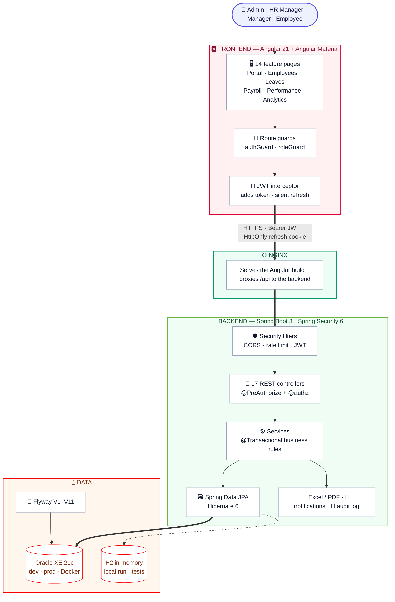
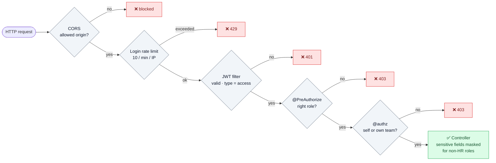
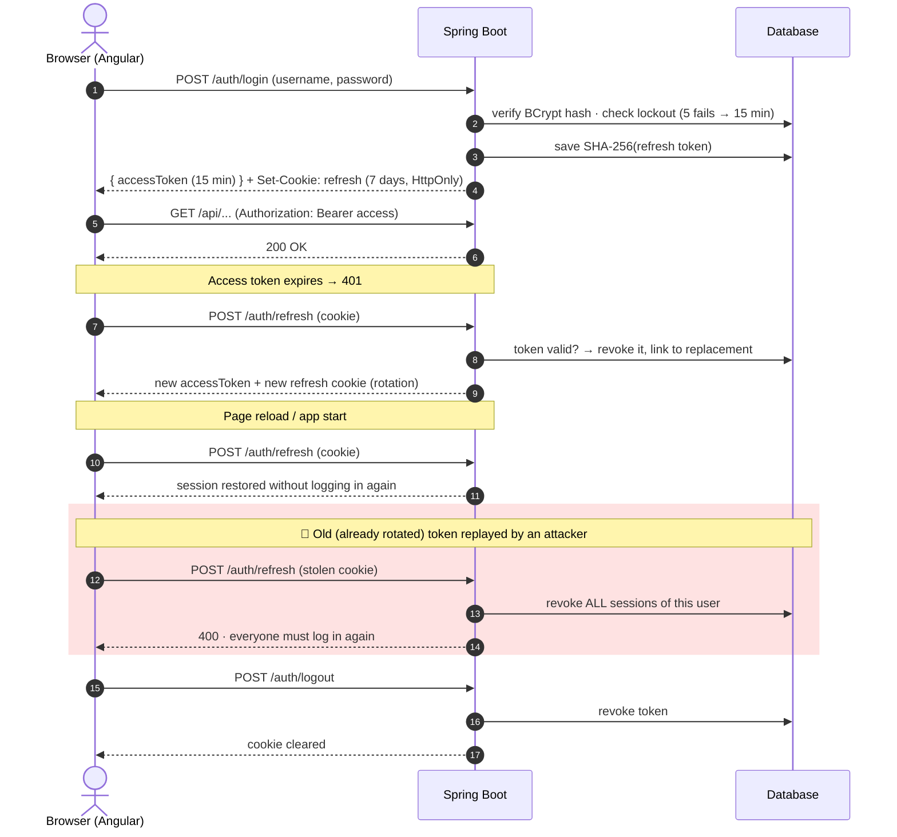
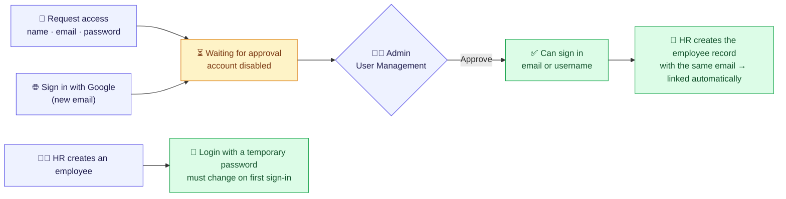
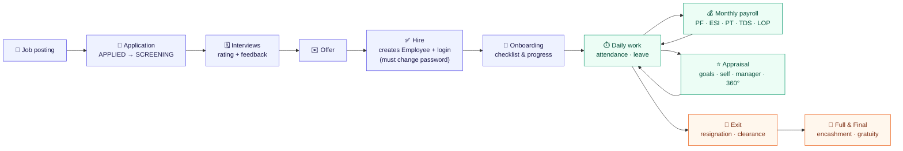

<div align="center">

# 🧠 HRGenius

### Full-Stack Human Resource Management System

*Recruitment → Onboarding → Attendance & Leave → Payroll → Performance → Exit — in one secure platform.*

[](https://github.com/ayukaushik1357-bit/HRGenius/actions)


</div>

---

## ✨ Highlights

| | |
|---|---|
| 🔐 **Real authentication** | Sign in with email or username, or with Google. Short-lived JWTs kept in memory, rotating refresh tokens in an HttpOnly cookie, stolen-token detection, lockout, password reset by email |
| 🙋 **Self sign-up with approval** | Anyone can request an account; nobody gets in until an administrator approves it |
| 🛡️ **Real authorization** | Role checks **plus** ownership checks on every endpoint: employees see only their own data, managers only their direct reports |
| 🇮🇳 **Indian payroll engine** | PF, ESI, Professional Tax, slab-based TDS and loss-of-pay, with PDF payslips |
| 📊 **HR analytics** | Headcount, attrition, tenure, payroll cost, hiring funnel and rating distribution, exportable to Excel and PDF |
| 🧪 **Tested** | 216 backend tests (incl. a 61-case authorization matrix and unmocked end-to-end account flows), 16 frontend tests, CI on every push |
| 🐳 **One-command deploy** | Docker Compose runs Oracle XE, Spring Boot and Angular behind Nginx |

---

## 🏛️ System Architecture



### How a request is protected

Every API call passes through five gates before it can read or change data:



---

## 🔐 Authentication Flow

Access tokens live **only in memory** (never in `localStorage`), so an XSS bug cannot steal a long-lived credential. The refresh token is an **HttpOnly** cookie that JavaScript cannot read; the database stores only its **SHA-256 hash**.



> A replay within **10 seconds** of a rotation whose new token is still unused is treated as a harmless race (fast reload, two tabs) and gets a fresh pair, so real users are not logged out.

### Getting an account



| Way in | How it works |
| :--- | :--- |
| **Email or username + password** | One field accepts either. 5 wrong passwords lock the account for 15 minutes; each network address is rate limited. |
| **Forgot password** | Sends a one-time link (valid 30 minutes, only its SHA-256 hash is stored). The answer is the same whether or not the email exists. Using it ends all other sessions. |
| **Sign in with Google** | Google's ID token is verified on the server (signature, issuer, audience, expiry, verified email). A known email signs in; an unknown email becomes a sign-up request. |
| **Request access** | Creates a disabled account and notifies administrators. It works only after an admin approves it. Optionally limited to company email domains. |
| **Created by HR** | Gets a temporary password that must be changed on first sign-in. |

A signed-in user who has no employee record yet sees a clear "not linked yet" message, never another employee's data.

---

## 🔄 Employee Lifecycle



---

## 🛠️ Technology Stack

| Layer | Technologies |
| :--- | :--- |
| **Backend** | Java 17, Spring Boot 3.2.5, Spring Security 6, Spring Data JPA, Hibernate 6, Bean Validation |
| **Auth** | JJWT 0.12 (HS512), BCrypt, HttpOnly refresh cookie, per-IP rate limit, account lockout, Google Identity Services + Spring Security OAuth2 JOSE (ID-token verification) |
| **Frontend** | Angular 21 (standalone components, signals), Angular Material, RxJS, Chart.js 4, SCSS |
| **Database** | Oracle XE 21c (`dev`, `prod`, Docker) · H2 in-memory (`h2` profile, tests) |
| **Migrations** | Flyway, 11 versioned scripts (`V1`–`V11`) |
| **Reports** | Apache POI 5.2 (Excel), OpenPDF 1.3 (payslips and analytics PDF) |
| **API docs** | springdoc-openapi (Swagger UI) |
| **Testing** | JUnit 5, Mockito, MockMvc, Spring Security Test · Vitest (frontend) |
| **DevOps** | Multi-stage Dockerfiles (Temurin 17, Node 22, Nginx), Docker Compose, GitHub Actions |

---

## 📦 Modules

<details open>
<summary><b>👥 Employees & Organisation</b></summary>

- Employee profiles with department, designation, reporting manager, emergency contact and address
- Document vault (ID proof, offer letter) with file-type/size checks and path-traversal protection
- PAN, Aadhaar and bank details are masked (`XXXX-XXXX-1234`) for everyone except HR/Admin and the employee themselves
- Departments and designations management
</details>

<details>
<summary><b>🧲 Recruitment & Onboarding</b></summary>

- Job postings (`DRAFT` → `OPEN` → `CLOSED`) linked to department and designation
- Candidate pipeline: `APPLIED` → `SCREENING` → `INTERVIEW` → `OFFERED` → `HIRED` / `REJECTED`
- Interview scheduling with interviewer, 1–5 rating and feedback; offers
- Hiring a candidate creates the employee record **and** a login with a temporary password
- Onboarding checklist templates assigned to new joiners with progress tracking
</details>

<details>
<summary><b>⏱️ Attendance & Leave</b></summary>

- Check-in / check-out; status from hours worked (≥ 7.5 h `PRESENT`, ≥ 4 h `HALF_DAY`)
- Monthly calendar view and company holiday calendar
- Casual, Sick, Earned and Unpaid leave with yearly quotas and live balances
- Overlap and balance checks; approval by the employee's **own manager** or HR (never self-approval)
</details>

<details>
<summary><b>💰 Payroll (Indian statutory)</b></summary>

| Component | Rule |
| :--- | :--- |
| Provident Fund | 12 % of (LOP-adjusted) basic |
| ESI | 0.75 % of gross when monthly gross ≤ ₹21,000 |
| Professional Tax | ₹200 / month when gross ≥ ₹10,000 |
| TDS | Annual slab calculation, deducted monthly |
| Loss of Pay | Pro-rated for unpaid leave and mid-month joiners |

Monthly payroll runs (`DRAFT` → `PROCESSED` → `PAID`, locked once paid) and downloadable PDF payslips. Employees can only see their own payslips.
</details>

<details>
<summary><b>⭐ Performance</b></summary>

- Review cycles created by HR; goals/KRAs with weightage and progress
- Workflow: `NOT_STARTED` → `SELF_REVIEW` → `MANAGER_REVIEW` → `COMPLETED`
- Final rating = **60 %** manager rating + **40 %** weighted goal score
- 360° peer feedback (not allowed on your own review)
</details>

<details>
<summary><b>🚪 Offboarding & Full-and-Final</b></summary>

- Resignation with notice period → departmental clearance checklist (`PENDING` / `CLEARED` / `WAIVED`)
- FnF settlement: payable days + leave encashment (basic ÷ 30 × days) + gratuity for ≥ 5 years (15 × basic ÷ 26 × years) − recoveries
- Finalising marks the employee `EXITED` and disables their login
</details>

<details>
<summary><b>📊 Analytics, Portal & Compliance</b></summary>

- Dashboard: headcount, attrition, average tenure, payroll cost, open requisitions, hiring vs exit trend, gender ratio, recruitment funnel, rating distribution. HR/Admin see the company, managers see their team.
- Excel and PDF export of the executive report
- Employee self-service portal: punch in/out, leave balance, latest payslip, holidays, profile change requests (HR approval required)
- Audit log of sensitive changes (salary, status, roles) with user, time, old/new value and IP
- In-app notifications plus asynchronous email (configurable SMTP)
</details>

---

## 🛡️ Roles & Permissions

| Area | ADMIN | HR_MANAGER | MANAGER | EMPLOYEE |
| :--- | :---: | :---: | :---: | :---: |
| User accounts, roles, unlock, approve sign-ups | ✅ | ❌ | ❌ | ❌ |
| Audit log | ✅ | ✅ | ❌ | ❌ |
| Employee list | ✅ all | ✅ all | 👥 team | ❌ |
| Employee profile | ✅ | ✅ | 👥 team | 🙋 self |
| Salary, PAN, Aadhaar, bank | ✅ | ✅ | 🔒 masked | 🙋 self |
| Create / edit employees | ✅ | ✅ | ❌ | ❌ |
| Documents | ✅ | ✅ | ❌ | 🙋 self |
| Attendance | ✅ | ✅ | 👥 team | 🙋 self |
| Approve leave | ✅ | ✅ | 👥 direct reports | ❌ |
| Payroll runs & salary structures | ✅ | ✅ | ❌ | ❌ |
| Payslips | ✅ | ✅ | ❌ | 🙋 self |
| Recruitment (candidates, offers, hire) | ✅ | ✅ | interviews & stages | ❌ |
| Review cycles | ✅ | ✅ | ❌ | ❌ |
| Appraisals | ✅ | ✅ | 👥 team (manager review) | 🙋 self review |
| Analytics dashboard | ✅ company | ✅ company | 👥 team | ❌ |
| Analytics export | ✅ | ✅ | ❌ | ❌ |
| Resignation / FnF finalise | ✅ | ✅ | approve & clear | 🙋 resign |

Rules are enforced on the **backend** (`@PreAuthorize` + the `@authz` ownership component); the Angular guards only hide what a user cannot open. The full endpoint-by-endpoint list is in [`docs/SECURITY_MATRIX.md`](docs/SECURITY_MATRIX.md).

---

## 🔑 Demo Accounts

The `h2` profile seeds **50 employees** across 5 departments, salary structures, leave balances, a payroll run, an appraisal cycle and audit entries.

| Role | Username | Password |
| :--- | :--- | :--- |
| Admin | `admin` | `Admin@123` |
| HR Manager | `hrmanager` | `Hr@123` |
| Manager | `manager` | `Manager@123` |
| Employee | `employee` | `Employee@123` |

---

## 🚀 Getting Started

**Prerequisites:** Java 17+, Node.js 22 with npm 11, Git. Maven is included via the wrapper.

### Option 1 · Local, no database setup (H2)

```bash
# Terminal 1 – backend (http://localhost:8080/api)
cd backend
./mvnw spring-boot:run          # Windows: .\mvnw.cmd spring-boot:run

# Terminal 2 – frontend (http://localhost:4200)
cd frontend
npm install
npm start
```

- Swagger UI: http://localhost:8080/api/swagger-ui.html
- H2 console: http://localhost:8080/api/h2-console (JDBC URL `jdbc:h2:mem:hrgenius`, user `sa`, empty password)

### Option 2 · Everything in Docker (Oracle + backend + frontend)

```bash
cp .env.example .env            # then set your own JWT_SECRET and passwords
docker compose up --build
```

| Service | URL / Port |
| :--- | :--- |
| Frontend (Nginx) | http://localhost |
| Backend API | http://localhost:8080/api |
| Oracle XE | `localhost:1521/XEPDB1` |

Stop with `docker compose down` (add `-v` to delete the database volume).

### Optional · Sign in with Google

1. In [Google Cloud Console](https://console.cloud.google.com/apis/credentials) set up the **OAuth consent screen**, then **Create credentials → OAuth client ID → Web application**.
2. Under **Authorized JavaScript origins** add `http://localhost:4200` (and `http://localhost` for Docker). No redirect URI is needed.
3. Start the backend with the client ID: `GOOGLE_CLIENT_ID=<your-client-id>.apps.googleusercontent.com` (or put it in `.env` for Docker).

The "Sign in with Google" button appears automatically once the ID is set.

### Password reset emails

Set `SPRING_MAIL_HOST` / `SPRING_MAIL_PORT` (and username/password if needed). Locally, without SMTP, the reset link is also written to the backend log (`log-password-reset-link`, always off in `prod`).

### Profiles

| Profile | Database | Schema | Demo data |
| :--- | :--- | :--- | :--- |
| `h2` *(default)* | H2 in-memory | Hibernate create-drop | ✅ |
| `dev` | Oracle XE on localhost | Flyway + `validate` | optional (`APP_SEED_DEMO_DATA=true`) |
| `prod` | Oracle via `ORACLE_URL` | Flyway + `validate` | ❌ · fails fast without a strong `JWT_SECRET` |

---

## 🧪 Testing

```bash
cd backend && ./mvnw verify     # 216 tests
cd frontend && npm test         # 16 tests
```

| Suite | What it proves |
| :--- | :--- |
| `SecurityRulesParameterizedTest` | 61 role / self / team / IDOR cases across all 17 controllers, using real JWTs |
| `RealFlowIntegrationTest` | Unmocked flows: stolen-token detection, reload race, analytics on real data |
| `AccountFlowIntegrationTest` | Email login, sign-up approval, lockout, password reset, Google sign-in, no data leak for unlinked accounts, no resigning on someone else's behalf |
| Service tests | Payroll (PF/ESI/PT/TDS/LOP), leave balances, appraisal scoring, FnF, lockout |

GitHub Actions runs the backend tests, the Angular production build and both Docker image builds on every push and pull request.

---

## 📁 Project Structure

```text
HRGenius/
├── backend/                         Spring Boot API
│   └── src/main/java/com/hrgenius/
│       ├── config/                  CORS, OpenAPI, auditing, demo-data seeder
│       ├── controller/              17 REST controllers
│       ├── dto/  mapper/            request/response models (entities never exposed)
│       ├── entity/                  JPA entities + converters
│       ├── exception/               global JSON error handling (400/401/403/404/409/423)
│       ├── repository/              Spring Data repositories and JPQL aggregates
│       ├── security/                JWT, filters, rate limiter, @authz rules
│       └── service/                 business logic and transactions
│   └── src/main/resources/db/migration/   Flyway V1–V11 (Oracle SQL)
├── frontend/                        Angular 21 SPA
│   └── src/app/
│       ├── core/                    guards, interceptor, services, models
│       ├── features/                landing page, sign-in/sign-up/reset pages, 14 app pages
│       └── layout/                  shell with role-aware sidebar
├── docs/SECURITY_MATRIX.md          endpoint-level access rules
├── docker-compose.yml  .env.example
└── .github/workflows/ci.yml
```

---

## 📚 Key API Endpoints

All paths are under `/api`. Full interactive docs are in Swagger UI.

| Method | Endpoint | Who |
| :--- | :--- | :--- |
| `POST` | `/auth/login` · `/auth/refresh` · `/auth/logout` · `/auth/logout-all` | public / logged in |
| `POST` | `/auth/change-password` | logged in |
| `GET` | `/auth/config` | public (is sign-up on, Google client ID) |
| `POST` | `/auth/register` | public, rate limited |
| `POST` | `/auth/password-reset/request` · `/auth/password-reset/confirm` | public, rate limited |
| `POST` | `/auth/google` | public, rate limited |
| `PUT` | `/users/{id}/status` | Admin (also approves sign-ups) |
| `GET` | `/employees` · `/employees/{id}` | HR, Admin, Manager (team), self |
| `POST` | `/attendance/check-in` · `/attendance/check-out` | logged in |
| `POST` | `/leaves` · `GET /leaves/balance` | logged in (self) |
| `POST` | `/leaves/{id}/action` | the employee's manager, HR, Admin |
| `POST` | `/payroll/runs` · `/payroll/runs/{id}/pay` | HR, Admin |
| `GET` | `/payroll/my-payslips` · `/payroll/payslips/{id}/pdf` | self, HR, Admin |
| `POST` | `/performance/reviews/{id}/self-review` · `/manager-review` | employee · their manager |
| `GET` | `/analytics/dashboard` · `/analytics/export/excel` · `/pdf` | Admin, HR (Manager: dashboard, team only) |
| `POST` | `/recruitment/hire` | HR, Admin |
| `POST` | `/offboarding/resign` · `/offboarding/settlement/{id}/finalize` | self · HR, Admin |
| `GET` | `/audit/logs` | Admin, HR |
| `GET` | `/users` | Admin |

---

## 📝 Notes

- Automated tests run on H2. The Flyway scripts are written for Oracle; run `docker compose up --build` to check the app against a real Oracle XE.
- Email notifications need an SMTP server (`SPRING_MAIL_HOST`, `SPRING_MAIL_PORT`); without one the app keeps working and only logs a warning.
