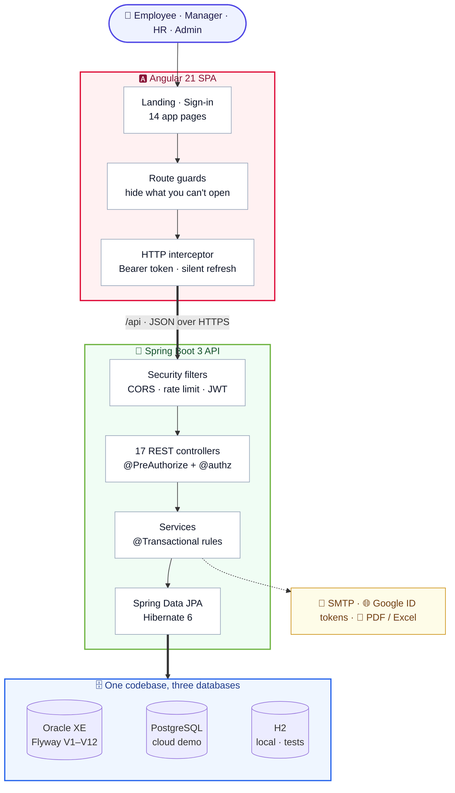
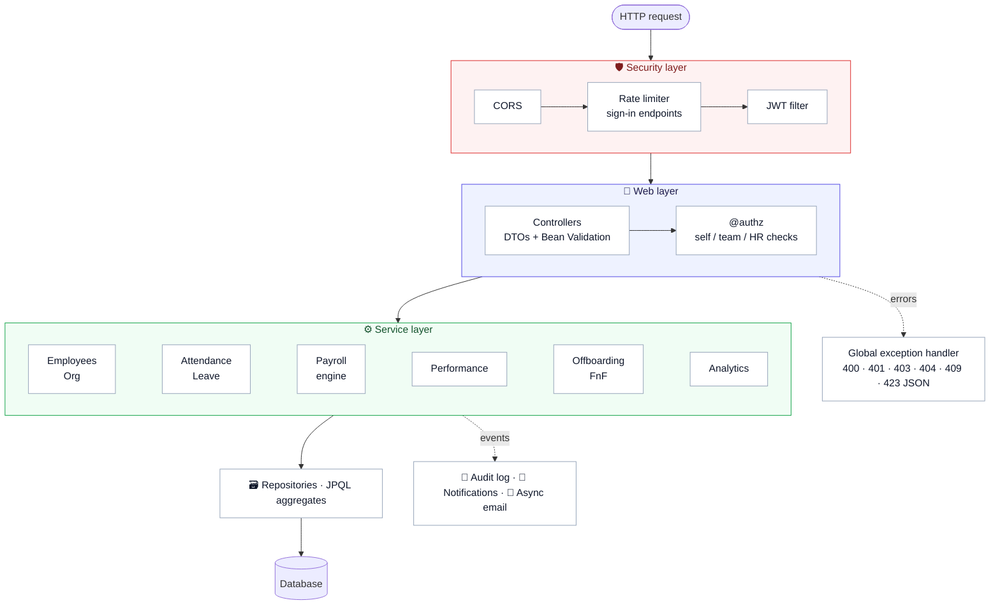
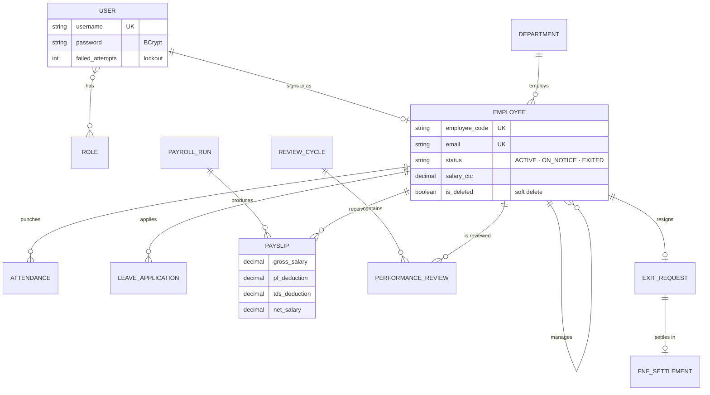
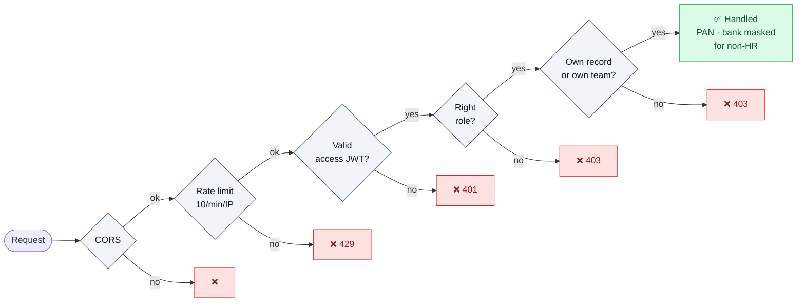
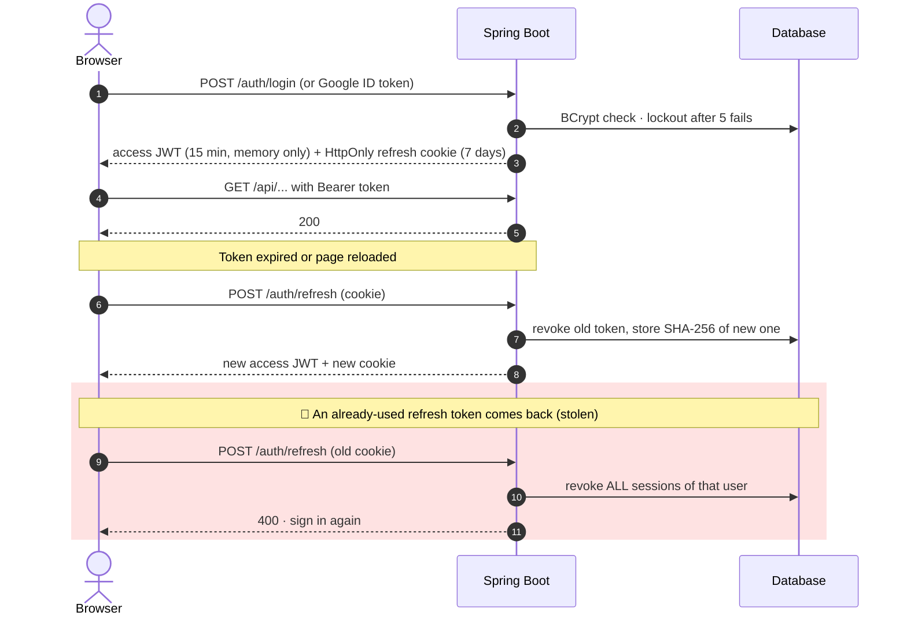
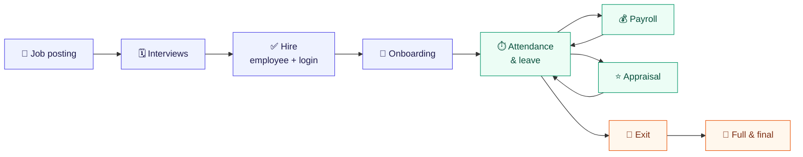
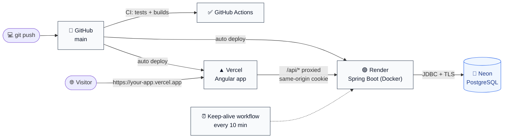

<div align="center">

# 🧠 HRGenius

**A full-stack HR platform: hiring, attendance, leave, Indian payroll, appraisals and exits in one secure system.**

[](https://github.com/ayukaushik1357-bit/HRGenius/actions)


[Architecture](#-architecture) · [Security](#-security) · [Features](#-features) · [Run it](#-run-it) · [Deploy](#-deploy-free-auto-deploys-on-push)

</div>

---

## ✨ Highlights

| | |
|---|---|
| 🔐 **Real auth** | Email/username or Google sign-in, open sign-up, 15-min JWTs in memory, rotating HttpOnly refresh cookie with stolen-token detection, lockout, password reset |
| 🛡️ **Real authorization** | Every endpoint checks the **role** and the **owner**: employees see only themselves, managers only their team |
| 🇮🇳 **Indian payroll** | PF, ESI, professional tax, slab-based TDS, loss of pay, PDF payslips |
| 📊 **Analytics** | Headcount, attrition, tenure, payroll cost, hiring funnel; Excel and PDF export |
| 🧪 **Tested** | 223 backend tests incl. a 61-case access matrix, 16 frontend tests, CI on every push |
| 🚀 **Runs anywhere** | One-command Docker (Oracle), free cloud demo (Vercel + Render + Neon), or zero-setup local H2 |

---

## 🏛️ Architecture

### The big picture



The same backend runs on three databases, picked by Spring profile:

| Profile | Database | Schema | Used for |
| :--- | :--- | :--- | :--- |
| `h2` *(default)* | H2 file in `backend/data` | Hibernate `update` | Local run, no setup, data kept across restarts |
| `dev` / `prod` | Oracle XE 21c | Flyway + `validate` | Docker Compose and production |
| `cloud` | PostgreSQL (Neon) | Hibernate `update` | Free hosted demo |

### Inside the backend



### Data model (core)



Deleted employees are **soft deleted**: hidden and unable to sign in, while their payslips, leave and attendance stay for audit.

---

## 🔐 Security

### Five gates on every request



### Sign-in and token rotation



### Who can do what

| | Admin | HR manager | Manager | Employee |
| :--- | :---: | :---: | :---: | :---: |
| Employee profiles | ✅ all | ✅ all | 👥 team | 🙋 self |
| Salary, PAN, bank | ✅ | ✅ | 🔒 masked | 🙋 self |
| Approve leave | ✅ | ✅ | 👥 direct reports | ❌ |
| Payroll runs | ✅ | ✅ | ❌ | ❌ |
| Payslips | ✅ | ✅ | ❌ | 🙋 self |
| Analytics | ✅ company | ✅ company | 👥 team | ❌ |
| Users, roles, audit log | ✅ | audit log | ❌ | ❌ |

New sign-ups start as **Employee**; the admin promotes people in **User Management**. Rules live on the server; the endpoint-by-endpoint list is in [`docs/SECURITY_MATRIX.md`](docs/SECURITY_MATRIX.md).

---

## 🧩 Features



| Module | What it does |
| :--- | :--- |
| 👥 **People** | Profiles, departments, designations, reporting lines, document vault, masked PAN/Aadhaar/bank |
| 🧲 **Recruitment** | Job postings, candidate pipeline, interviews with ratings, offers; hiring creates the employee and a login |
| ⏱️ **Attendance & leave** | Check-in/out, half days, holiday calendar, casual/sick/earned/unpaid quotas, approval by the employee's own manager |
| 💰 **Payroll** | Monthly runs (draft → processed → paid, locked once paid) and PDF payslips |
| ⭐ **Performance** | Review cycles, weighted goals, self and manager review, 360° feedback; rating = 60 % manager + 40 % goals |
| 🚪 **Offboarding** | Resignation, clearance checklist, full and final with leave encashment and gratuity |
| 📊 **Analytics & portal** | Company or team dashboard, Excel/PDF export, self-service portal, audit log, notifications |

<details>
<summary><b>💰 Payroll rules</b></summary>

| Component | Rule |
| :--- | :--- |
| Provident fund | 12 % of basic (after loss of pay) |
| ESI | 0.75 % of gross when gross ≤ ₹21,000 |
| Professional tax | ₹200 / month when gross ≥ ₹10,000 |
| TDS | Annual slab tax, deducted monthly |
| Loss of pay | Pro-rated for unpaid leave and mid-month joiners |
| Gratuity (FnF) | 15 × basic ÷ 26 × years, after 5 years |

</details>

---

## 🛠️ Tech Stack

| | |
| :--- | :--- |
| **Backend** | Java 17 · Spring Boot 3.2 · Spring Security 6 · Spring Data JPA / Hibernate 6 · Bean Validation |
| **Auth** | JJWT (HS512) · BCrypt · HttpOnly cookies · Google Identity Services + OAuth2 JOSE |
| **Frontend** | Angular 21 (standalone, signals) · Angular Material · RxJS · Chart.js · SCSS |
| **Data** | Oracle XE 21c · PostgreSQL · H2 · Flyway |
| **Reports** | Apache POI (Excel) · OpenPDF (payslips, reports) |
| **Quality** | JUnit 5 · Mockito · MockMvc · Vitest · GitHub Actions |
| **Ops** | Docker multi-stage builds · Docker Compose · Nginx · Vercel · Render · Neon |

---

## 🚀 Run it

**Needs:** Java 17+, Node.js 22, Git.

### Local, no database setup

```bash
# backend → http://localhost:8080/api   (Windows: .\mvnw.cmd spring-boot:run)
cd backend
export ADMIN_PASSWORD='Choose-a-strong-one1!'   # PowerShell: $env:ADMIN_PASSWORD="Choose-a-strong-one1!"
./mvnw spring-boot:run

# frontend → http://localhost:4200
cd frontend && npm install && npm start
```

- Sign in as `admin` with your `ADMIN_PASSWORD`, or **Create account**. Demo logins: `hrmanager / Hr@123`, `manager / Manager@123`, `employee / Employee@123`.
- 50 sample employees are loaded. Data is saved in `backend/data`; delete that folder to start fresh.
- API docs: http://localhost:8080/api/swagger-ui.html

### Docker (Oracle + backend + frontend)

```bash
cp .env.example .env        # set JWT_SECRET, ADMIN_PASSWORD, database passwords
docker compose up --build   # app on http://localhost, API on :8080
```

### Google sign-in with your own client

In [Google Cloud Console](https://console.cloud.google.com/apis/credentials): create a **Web application** client, add every address the app runs on under **Authorized JavaScript origins**, **Publish** the app, and start the backend with `GOOGLE_CLIENT_ID=<id>`. No client secret is used.

---

## ☁️ Deploy (free, auto-deploys on push)



1. **Neon:** create a project (region Singapore), turn **connection pooling off**, copy host, database, user and password.
2. **Render:** *New → Web Service* → this repo, **Root Directory** `backend`, **Docker**, **Free**, health check `/api/auth/config`, with these variables:

   | Variable | Value |
   | :--- | :--- |
   | `SPRING_PROFILES_ACTIVE` | `cloud` |
   | `DB_URL` | `jdbc:postgresql://<host>/<database>?sslmode=require` |
   | `DB_USERNAME` · `DB_PASSWORD` | from Neon |
   | `JWT_SECRET` | 64+ random characters |
   | `ADMIN_PASSWORD` | password for `admin` |
   | `APP_FRONTEND_URL` · `CORS_ALLOWED_ORIGINS` | your Vercel URL |
   | `APP_SEED_DEMO_DATA` | `false` to start without the 50 sample employees |

3. **Vercel:** make sure the Render URL in [`frontend/vercel.json`](frontend/vercel.json) is right, then *Add New → Project* → this repo, **Root Directory** `frontend`.
4. **Google:** add the Vercel URL to **Authorized JavaScript origins**.
5. **Keep awake** *(optional)*: add the repository variable `BACKEND_URL` = Render URL. Free Render services otherwise sleep after 15 idle minutes.

---

## 🧪 Tests

```bash
cd backend && ./mvnw verify   # 223 tests
cd frontend && npm test       # 16 tests
```

| Suite | Proves |
| :--- | :--- |
| `SecurityRulesParameterizedTest` | 61 role, self, team and IDOR cases across all controllers with real JWTs |
| `RealFlowIntegrationTest` | Stolen-token detection, reload race, analytics on real data |
| `AccountFlowIntegrationTest` | Sign-up, email and Google sign-in, lockout, password reset |
| `DeleteRulesIntegrationTest` | Soft delete keeps history; records in use return a clear 409 |
| Service tests | PF, ESI, PT, TDS, LOP, leave balances, appraisal score, FnF |

---

## 📁 Project Structure

```text
HRGenius/
├── backend/                 Spring Boot API
│   └── src/main/java/com/hrgenius/
│       ├── security/        JWT, filters, rate limiter, @authz rules
│       ├── controller/      17 REST controllers
│       ├── service/         business rules and transactions
│       ├── repository/      Spring Data + JPQL aggregates
│       ├── entity/ dto/     JPA entities, request/response models
│       └── config/          CORS, OpenAPI, demo data, admin password
├── frontend/                Angular 21 SPA (core/, features/, layout/)
├── docs/SECURITY_MATRIX.md  endpoint access rules
├── docker-compose.yml       Oracle + backend + Nginx frontend
└── .github/workflows/       CI and keep-alive
```
